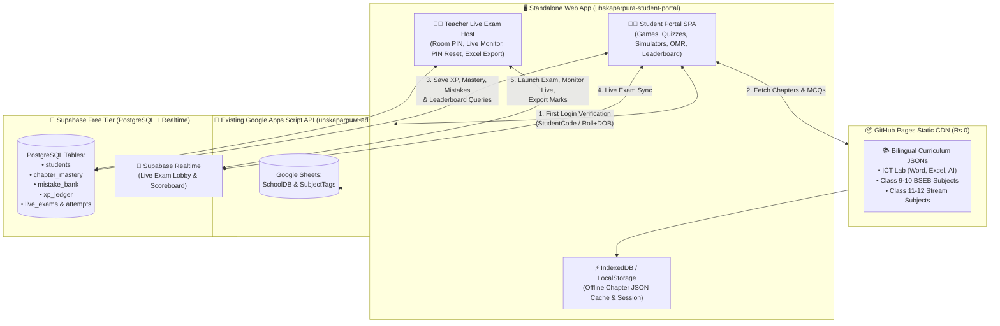
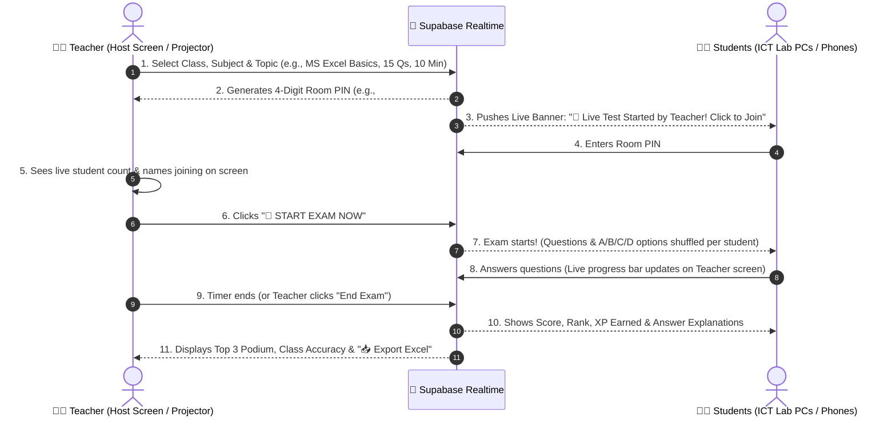

# 🎓 U.H.S. Kaparpura — Gamified Student Learning & Live Evaluation Portal (`studentportal.md`)

> **Master Architectural & Product Specification**  
> **Target Audience**: Class 9, 10, 11 & 12 Students of **U.H.S. Kaparpura, Kanti, Muzaffarpur** (Phase 1–3), designed with multi-tenant scalability for **1,000–5,000+ students** across Bihar Board (BSEB) and CBSE schools (Phase 4).  
> **Core Mission**: Transform every minute a student spends in the ICT Lab or on their phone into **measurable practical computer skills** and **higher marks in the Bihar Board (BSEB) examinations**.
>
> **Live Standalone GitHub Repo**: https://github.com/EternalStud/uhskaparpura-student-portal`n> **Live Supabase PostgreSQL Project**: lvrsanukztinwqrgivth (https://lvrsanukztinwqrgivth.supabase.co)
> **Cross-Device Sync (Windows School PC & Home Mac Mini)**: See [studentPortalsofar.md](./studentPortalsofar.md) for current build status and macOS/Windows terminal commands.

---

## 🧭 1. Executive Summary & Core Design Decisions

Following a thorough architectural review of the existing live school ecosystem (`uhskaparpura-admin-api`, `uhskaparpura-admin-web`, `uhskaparpurakanti-website`), the Student Portal will be built around **7 foundational pillars**:

1. **Zero Interference with Live Portals (Standalone Repo)**:
   * Built in a dedicated repository (`uhskaparpura-student-portal`) containing both the **Student Learning Portal** and the **Teacher Live Exam Host**.
   * Zero risk of breaking live admissions, registrations, or result generation. Once battle-tested in the ICT Lab, a single button/link will be added on `uhskaparpurakanti.in`.
2. **Hybrid Zero-Cost Architecture (Scales to 5,000+ Students)**:
   * **Identity & Subject Source of Truth**: Existing Google Apps Script API (`uhskaparpura-admin-api`) verifies students against `SchoolDB` and fetches their verified BSEB subjects from `SubjectTags`.
   * **High-Speed Game, Leaderboard & Live Exam Engine**: **Supabase Free Tier (PostgreSQL + Realtime WebSockets)** handles concurrent quiz submissions, XP ledgers, leaderboards, and live 40-PC ICT Lab exams in `<50ms` without hitting Google Sheets concurrency limits.
   * **Zero-Cost Content Delivery**: Chapter notes, bilingual MCQs, and ICT simulator challenges are stored as versioned static JSON files on GitHub Pages CDN with browser `IndexedDB`/`localStorage` caching.
3. **School-Verified Student Login + Shared ICT Lab PC Safety**:
   * Students log in using **`Student Code`** OR **`Class + Stream + Roll No + DOB`** (identical to the Registration Portal).
   * Supports an optional **4-Digit Secret PIN** (with 1-click Teacher Reset in the ICT Lab) and a prominent **"Switch Student / End Lab Session"** button for shared lab computers.
4. **Bilingual "Bridge" Engine (Hindi + English + Side-by-Side)**:
   * Every concept, question, and explanation supports **Hindi**, **English**, and **Side-by-Side Bilingual (द्विभाषी)** mode, plus tap-to-translate technical vocabulary tooltips so Hindi-medium students master English computer/science terms effortlessly while English-medium/CBSE students enjoy crisp English.
5. **BSEB Board Exam Score Booster Engine**:
   * Specifically targets Bihar Board's **50% Objective OMR Pattern** (2x choices, e.g., 40/80 or 50/100) and automatically tracks wrong answers in a personal **"Mistake Notebook" (गलती सुधार बैंक)** using spaced repetition until the student achieves 100% mastery.
6. **Phase 1 Flagship — ICT Lab Interactive Curriculum**:
   * Starts with **Microsoft Word**, **Microsoft Excel**, **Artificial Intelligence (AI)**, and **Computer Fundamentals** using interactive keyboard shortcut simulators, ribbon detectives, and a mini Excel formula sandbox.
7. **On-Demand Live Teacher Exam (In-Person Classroom/Lab Evaluation)**:
   * Teachers can launch a live timed test right after teaching a topic via a **4-Digit Room PIN + Auto-Dashboard Banner**, with per-student question/option shuffling (preventing side-by-side copying in the ICT lab), tab-switch detection, live projector scoreboard, and 1-click Excel mark export.

---

## 🏗️ 2. System Architecture & Data Flow



### Why This Hybrid Stack Is Optimal
| Requirement | Why Pure Google Sheets Fails at Scale | How Our Hybrid Architecture Solves It |
| :--- | :--- | :--- |
| **35+ ICT Lab PCs submitting a live test at the same second** | Apps Script has a hard limit of 30 concurrent executions and Sheets takes 1–3s per row lock. | **Supabase PostgreSQL + WebSockets** handles 500+ concurrent connections in `<30ms`. |
| **Student practicing 100 MCQs daily** | 100 Sheet reads/writes per student = quota exhaustion. | Questions load from **Static JSON CDN** (0 DB reads); only final quiz summary writes 1 row to Supabase. |
| **Only genuine U.H.S. Kaparpura students allowed** | Duplicate manual student entry in a new DB causes sync drift. | Verifies directly against existing **`SchoolDB` & `SubjectTags`** via a lightweight GAS endpoint on login. |
| **Scaling to 1,000–5,000 students (Multi-School)** | Single spreadsheet slows down past 10,000 rows. | Every Supabase table includes `school_id` (`UHS_KAPARPURA_51375`). Adding another school requires only a new `school_id` config. |

---

## 🔐 3. Authentication & Shared ICT Lab PC Workflow

### 3.1 Dual Student Login (Consistent with Registration Portal)
Students can log in via two tabs on the login screen:
* **Tab A — By Student Code**: Enter `Class` + `Student Code` (e.g., `202410141306317`).
* **Tab B — By Roll No & DOB**: Enter `Class` (9, 10, 11, 12) + `Stream` (if Class 11/12: Arts/Science/Commerce) + `Roll No` + `Date of Birth (DD/MM/YYYY)`.

### 3.2 First-Login Handshake & Subject Auto-Discovery
1. When a student logs in for the first time (or clicks *"Sync Profile"*):
   * The app calls `uhskaparpura-admin-api` (`action=public.portal.verifyStudent`).
   * The API checks `SchoolDB` for the student's identity and `SubjectTags` (or `Registrations`) for their exact BSEB subjects (e.g., Language 1: Hindi, Language 2: Sanskrit, Electives: History, Pol. Science, Geography).
   * The profile is upserted into Supabase's `students` table.
2. **Subsequent Logins**: Verified directly against Supabase in `<150ms` (with automatic fallback to GAS if not yet synced).

### 3.3 Shared ICT Lab Computer Protections
Because multiple shifts of students use the same desktop computers in the ICT Lab:
* **Optional 4-Digit Secret PIN**:
  * After first login, a student can set a simple 4-digit PIN (e.g., `1234`) so classmates who know their Roll Number cannot log into their account from another PC.
  * **1-Click Teacher PIN Reset**: If a student forgets their PIN, the Teacher Dashboard has a 1-click *"Reset PIN"* button next to the student's name.
* **Prominent "Switch Student / Lab Logout" Bar**:
  * Top navbar always displays: `👤 Ankit Kumar (Class 11 Arts • Roll 2) | 🔄 Switch Student (लॉगआउट)`.
* **ICT Lab "Buddy / Pair Mode" (Optional 2-Student Login)**:
  * Often in school computer labs, 2 students sit at 1 PC. A *"➕ Add Lab Partner (सहपाठी जोड़ें)"* button lets a second student log in alongside the primary student during practice modules so both receive lab attendance credit.

---

## 🌐 4. Bilingual Pedagogy Engine (Hindi + English + CBSE/BSEB Bridge)

Bihar Board students often struggle with pure English terminology, especially in Computer Science & ICT, while CBSE or English-medium students prefer English.

### 4.1 Three-State Language Switcher (Persistent in Header)
Students can switch languages at any moment (even mid-question without losing progress):
1. **`हिन्दी (Hindi)`**: Questions and options in clear Hindi, with standard English technical terms in brackets — e.g., `एमएस एक्सेल (MS Excel) में किसी रेंज का जोड़ निकालने के लिए कौन-सा फॉर्मूला उपयोग होता है?`
2. **`English`**: Crisp, standard NCERT/CBSE-grade English — e.g., `Which formula is used to calculate the total of a cell range in MS Excel?`
3. **`द्विभाषी (Bilingual Side-by-Side)`**: Displays both Hindi and English stacked cleanly so students build English reading confidence while relying on Hindi comprehension.

### 4.2 Interactive "Tap-to-Learn" Tech Glossary (`शब्दकोश चिप्स`)
* Key technical terms in ICT & Science (e.g., *Spreadsheet, Cell Reference, Algorithm, Artificial Intelligence, Formatting, Clipboard*) are highlighted with a subtle dotted underline.
* Clicking/tapping the word opens a micro-card with:
  * **English Word**: `Spreadsheet`
  * **Hindi Pronunciation**: `स्प्रेडशीट`
  * **Simple Desi Explanation**: `एक डिजिटल रजिस्टर जिसमें डेटा को पंक्तियों (Rows) और स्तंभों (Columns) में रखकर हिसाब-किताब किया जाता है।`

---

## 🎮 5. Interactive Learning Modes & Simulators

Instead of boring static PDFs, every chapter is broken into **5-minute Bite-Sized Missions**:

### Mode 1: ⚡ KBC "Kaun Banega Champion" Speed Quiz
* **Mechanics**: 10–15 curated MCQs per topic with a visual timer, streak multiplier (`2x`, `3x`, `5x` Fire Streak), and sound effects (muteable).
* **3 Lifelines per Quiz**:
  * `50:50` (eliminates 2 wrong options)
  * `💡 Teacher Hint` (shows a clue without giving away the answer)
  * `⏳ +15 Seconds` (freezes the timer)
* **Instant Learning Loop**: Every answer (right or wrong) immediately shows a **2-line Bilingual Concept Card** explaining *why* that option is correct.

### Mode 2: ⌨️ Shortcut Ninja & Ribbon Detective (ICT Lab Special)
* **Keyboard Shortcut Simulator**:
  * Visual on-screen keyboard + real physical keyboard listener for ICT Lab PCs.
  * Prompt: *"Make the selected heading BOLD in MS Word!"* ➔ Student presses `Ctrl + B` on the physical keyboard (or taps `Ctrl` + `B` on mobile) to score combo points!
* **UI Ribbon / Toolbar Detective**:
  * Displays a clean mock MS Word / MS Excel toolbar ribbon.
  * Prompt: *"Click the icon used to Merge & Center cells in Excel"* or *"Click the Font Color tool"* ➔ Student clicks the exact toolbar icon on the interface.

### Mode 3: 📊 Mini Excel Formula Sandbox (Practical Simulator)
* Renders a lightweight, interactive 5-column × 6-row spreadsheet directly in the browser (e.g., a mini U.H.S. Kaparpura student marks table).
* **Interactive Missions**:
  * *Mission 1*: "Type the formula in cell `E2` to add Hindi (`B2`), English (`C2`), and Math (`D2`) marks." (`=SUM(B2:D2)` or `=B2+C2+D2`).
  * *Mission 2*: "Find the highest marks in the class using `=MAX(E2:E6)`."
  * *Mission 3*: "Write an `=IF` formula to show PASS if marks >= 30."
* Validates the student's formula in real time and animates the calculated cell result!

### Mode 4: 🧩 Drag-and-Drop Concept Matcher & Flowchart Builder
* **Match Pairs**: Match `Ctrl+C` ➔ `Copy`, `CPU` ➔ `Brain of Computer`, `ChatGPT` ➔ `Generative AI`, `.xlsx` ➔ `MS Excel File Extension`.
* **Sequence / Step Builder**: Drag steps into the correct order (e.g., *Steps to Save a Word Document as PDF*, or *Input ➔ Process ➔ Output*).

### Mode 5: 📝 BSEB 50% Objective OMR Board Simulator (Marks Booster)
* **Why This Directly Boosts Board Exam Marks**:
  * In Bihar Board Class 10 & 12 exams, **50% of marks come from OMR MCQs where double the questions are printed** (e.g., 80 questions printed, student must bubble any 40; or 100 printed, bubble any 50).
  * Many students lose marks in the real exam because they waste time on hard questions instead of picking the easiest 50%, or they bubble the wrong OMR circle.
* **How the Simulator Works**:
  * Gives the student a real BSEB-style question paper (e.g., 80 questions, 40 to attempt) with a **Digital Pink/Blue OMR Sheet** on the side.
  * Teaches **Smart Question Selection Strategy**: Highlights whether the student picked the easiest 40 questions and warns if they attempt more than the first 40 limit.
  * Tags every question with `[BSEB 2023]`, `[BSEB 2024]`, `[BSEB Model Paper]` badges.

### Mode 6: 🧠 Automatic "Mistake Notebook" (गलती सुधार बैंक)
* Whenever a student answers any question wrong in a quiz or live test, that question is automatically added to their personal **`Mistake Bank`**.
* On the student's home screen, a badge shows: `🔴 8 Questions in Your Mistake Bank — Clear them to earn +50 Bonus XP!`.
* A question is only removed from the Mistake Bank after the student answers it correctly **twice in a row** on different days (Spaced Repetition).

---

## 📚 6. Phase-Wise Curriculum Roadmap

### 🚀 Phase 1: ICT Lab Flagship (For All Classes 9–12)
Designed so teachers can use it immediately in the school ICT Lab during computer periods:

| Module ID | Chapter Title (Bilingual) | Key Topics & Practical Simulators |
| :--- | :--- | :--- |
| **`ICT_01`** | **Computer Fundamentals & OS**<br>*(कंप्यूटर का परिचय एवं ऑपरेटिंग सिस्टम)* | Hardware vs. Software, Input/Output devices, CPU (ALU, CU, MU), RAM vs. ROM, Windows desktop, Files, Folders & File Extensions (`.docx`, `.xlsx`, `.pdf`, `.jpg`). |
| **`ICT_02`** | **Microsoft Word Mastery**<br>*(एमएस वर्ड मास्टरी)* | Creating/Saving docs, Font & Paragraph formatting, Bullets, Tables, Page Setup (Margins, Orientation), Header/Footer, Top 25 MS Word Keyboard Shortcuts (`Ctrl+A` to `Ctrl+Z`, `F7`), Mail Merge basics. |
| **`ICT_03`** | **Microsoft Excel Mastery**<br>*(एमएस एक्सेल एवं स्प्रेडशीट)* | Workbook vs. Worksheet, Rows, Columns & Cell Addresses (`A1`, `B10`), Data Entry, AutoFill, Essential Formulas (`=SUM`, `=AVERAGE`, `=COUNT`, `=MAX`, `=MIN`, `=IF`), Sorting, Filtering & Charts. |
| **`ICT_04`** | **Artificial Intelligence (AI) & Future Tech**<br>*(कृत्रिम बुद्धिमत्ता - AI का परिचय)* | What is AI vs. Human Intelligence, Real-life AI examples (Voice Assistants, Maps, Face Unlock, ChatGPT/Gemini), Machine Learning basics, Writing Good Prompts, AI Ethics, Deepfakes & Cyber Safety (OTP/Phishing protection). |
| **`ICT_05`** | **Internet, Email & Digital India**<br>*(इंटरनेट, ईमेल एवं साइबर सुरक्षा)* | Web Browsers, Search Engines, Creating & Sending Email (To, CC, BCC, Attachments), DigiLocker, APAAR ID, e-Shikshakosh, UPI safety, Strong Passwords. |

### 📈 Phase 2: Class 9 & 10 (BSEB Matric + NCERT Core)
* **Mathematics (गणित)**: Formula Flashcards + Step-by-Step MCQ Solvers (Real Numbers, Polynomials, Trigonometry, Mensuration, Statistics, Probability).
* **Science (विज्ञान)**: Physics, Chemistry & Biology chapter-wise PYQs, Periodic Table game, Ray Diagram & Human Body label matchers.
* **Social Science (सामाजिक विज्ञान)**: History dates/events timeline game, Civics, Geography map basics, Economics.
* **Languages**: Hindi (गद्य/पद्य + व्याकरण), English Grammar & Literature, Sanskrit / Urdu.

### 🎓 Phase 3: Class 11 & 12 (Stream-Isolated via `SubjectTags`)
* Automatically displays **only the subjects tagged to the logged-in student**:
  * **Science**: Physics, Chemistry, Biology, Mathematics, Computer Science.
  * **Arts**: History, Political Science, Geography, Economics, Psychology, Home Science, Sociology, Philosophy.
  * **Commerce**: Accountancy, Business Studies, Entrepreneurship, Economics.
  * **Compulsory Languages**: Hindi (`306`/`106`), English (`305`/`105`), Urdu, Maithili, Sanskrit.

---

## 👩‍🏫 7. Teacher's "On-Demand Live Exam" Host (Classroom Presence Mode)

When a teacher finishes teaching a chapter or practical in the ICT Lab or classroom, they can conduct an **instant 10-minute evaluation** in their physical presence.

### 7.1 Step-by-Step Classroom Workflow


### 7.2 Built-In Anti-Cheating for the ICT Lab
1. **Per-Student Question & Option Shuffling (Fisher-Yates)**:
   * Student sitting on PC #1 sees Question 5 first with answer `B`.
   * Student sitting right next to them on PC #2 sees Question 12 first, and when they reach Question 5, the options are shuffled so the answer is `D`.
   * **Result**: Looking at a neighbor's monitor in the ICT Lab is 100% useless!
2. **Fullscreen & Tab-Switch Alert (`visibilitychange` & `blur` listener)**:
   * During a Live Exam, if a student switches tabs or minimizes the browser to search Google, a warning banner triggers and increments `tab_switches` on the Teacher's live monitor screen (`⚠️ Roll 14 switched tab 1 time`).
3. **PIN + Presence Lock**:
   * Only students who enter the 4-digit Room PIN written on the blackboard by the teacher can join, and the Teacher can lock the room once everyone in the lab has joined.
4. **1-Click Teacher Excel Export & Question Creator**:
   * At the end of the test, the teacher clicks **"📥 Download Result Excel"** to get a clean spreadsheet (`Roll No`, `Student Name`, `Class`, `Score`, `Percentage`, `Time Taken`, `Tab Switches`).
   * Teachers can also add custom questions via a simple **"➕ Add Custom Question / Paste from Excel"** modal.

---

## 🏆 8. Fair Gamification, Anti-Farming XP & Leaderboards

### 8.1 Smart Anti-Farming XP Formula
To ensure students cannot "cheat" the leaderboard by playing the same easy Chapter 1 quiz 50 times:

* **First-Time Question Mastery**: `+10 XP` per unique question answered correctly for the first time.
* **Revision / Re-Attempt Cap**: Replaying an already-completed chapter awards `+2 XP` per question **only once per day** (encourages genuine revision without point-farming).
* **Mistake Bank Clearance**: `+15 XP` when a previously wrong question in the Mistake Bank is mastered.
* **Daily Study Streak**: `+25 XP` daily login + 1 quiz completion bonus (`🔥 7-Day Streak = +100 Bonus XP`).
* **Teacher On-Demand Live Exam (2x Multiplier)**: `+20 XP` per correct answer + `+50 XP` Podium Bonus for Top 3 in class!

### 8.2 Three-Tier Leaderboard System
1. **🏫 My Class & Stream Leaderboard** (Default view):
   * Compares like with like (e.g., *Class 11 Arts* students compete with *Class 11 Arts*; *Class 10* with *Class 10*).
2. **💻 ICT Lab Champions Leaderboard**:
   * Ranks students specifically on Computer Science, MS Word, MS Excel, and AI modules across the school.
3. **🌟 Weekly Rising Star Leaderboard (Resets Every Monday 12:00 AM IST)**:
   * Ensures a student who starts in November can still become **#1 Student of the Week** even if another student has higher all-time XP since October!

### 8.3 Badges, Ranks & Printable Certificates
* **Student Ranks**: `🌱 Shiksharthi (Beginner)` ➔ `📘 Jigyasu (Learner)` ➔ `⚡ Vidwan (Scholar)` ➔ `💻 Digital Maharathi (ICT Master)` ➔ `👑 Bihar Board Champion`.
* **Printable "Star of the Week" Certificate**: Teachers can 1-click print an A4 certificate for the Weekly Class Topper or Live Exam Winner to pin on the school noticeboard!

---

## 🗄️ 9. Database Schema (Supabase PostgreSQL + Static JSON)

### 9.1 Supabase PostgreSQL Tables (SQL DDL)

```sql
-- 1. Schools Table (Multi-Tenant Ready for 1k-5k Student Scaling)
CREATE TABLE schools (
    school_id TEXT PRIMARY KEY DEFAULT 'UHS_KAPARPURA_51375',
    school_name TEXT NOT NULL,
    udise_code TEXT,
    board TEXT DEFAULT 'BSEB',
    is_active BOOLEAN DEFAULT TRUE,
    created_at TIMESTAMPTZ DEFAULT NOW()
);

-- 2. Students Table (Synced from Google Sheets SchoolDB on login)
CREATE TABLE students (
    id UUID PRIMARY KEY DEFAULT gen_random_uuid(),
    school_id TEXT REFERENCES schools(school_id) DEFAULT 'UHS_KAPARPURA_51375',
    student_id TEXT NOT NULL,               -- studentCode or derived ID (YYYY_C_S_SEC_ROLL)
    student_code TEXT,
    roll_no INTEGER NOT NULL,
    class_num INTEGER NOT NULL,             -- 9, 10, 11, 12
    stream TEXT DEFAULT '',                 -- '', 'Arts', 'Science', 'Commerce'
    section TEXT DEFAULT 'A',
    academic_year TEXT NOT NULL,            -- e.g. '2026-27'
    student_name TEXT NOT NULL,
    father_name TEXT,
    dob TEXT,                               -- Normalized DD/MM/YYYY
    gender TEXT,
    medium TEXT DEFAULT 'Hindi',            -- 'Hindi' or 'English'
    pin_hash TEXT,                          -- Optional 4-digit PIN for shared ICT Lab PCs
    subjects JSONB DEFAULT '[]'::jsonb,     -- Verified subject IDs from SubjectTags
    total_xp INTEGER DEFAULT 0,
    weekly_xp INTEGER DEFAULT 0,
    ict_xp INTEGER DEFAULT 0,
    current_streak INTEGER DEFAULT 0,
    last_active_date DATE,
    badges JSONB DEFAULT '[]'::jsonb,
    updated_at TIMESTAMPTZ DEFAULT NOW(),
    UNIQUE(school_id, student_id)
);

-- 3. Chapter Mastery & Question Progress (Prevents XP Farming)
CREATE TABLE chapter_progress (
    id UUID PRIMARY KEY DEFAULT gen_random_uuid(),
    school_id TEXT NOT NULL DEFAULT 'UHS_KAPARPURA_51375',
    student_id TEXT NOT NULL,
    subject_id TEXT NOT NULL,               -- e.g. 'ICT_LAB', '10_SCI', '11_ART_HIS'
    chapter_id TEXT NOT NULL,               -- e.g. 'ICT_03_EXCEL'
    mastered_question_ids JSONB DEFAULT '[]'::jsonb,
    best_score_pct NUMERIC(5,2) DEFAULT 0,
    stars INTEGER DEFAULT 0,                -- 0 to 3 stars
    attempts_count INTEGER DEFAULT 0,
    last_played_at TIMESTAMPTZ DEFAULT NOW(),
    UNIQUE(school_id, student_id, chapter_id)
);

-- 4. Personal Mistake Notebook (Spaced Repetition Engine)
CREATE TABLE mistake_bank (
    id UUID PRIMARY KEY DEFAULT gen_random_uuid(),
    school_id TEXT NOT NULL DEFAULT 'UHS_KAPARPURA_51375',
    student_id TEXT NOT NULL,
    question_id TEXT NOT NULL,
    subject_id TEXT NOT NULL,
    chapter_id TEXT NOT NULL,
    wrong_count INTEGER DEFAULT 1,
    consecutive_correct INTEGER DEFAULT 0,  -- Cleared when reaches 2
    is_resolved BOOLEAN DEFAULT FALSE,
    last_tested_at TIMESTAMPTZ DEFAULT NOW(),
    UNIQUE(school_id, student_id, question_id)
);

-- 5. Teacher On-Demand Live Exams
CREATE TABLE live_exams (
    exam_id UUID PRIMARY KEY DEFAULT gen_random_uuid(),
    school_id TEXT NOT NULL DEFAULT 'UHS_KAPARPURA_51375',
    room_pin TEXT NOT NULL,                 -- 4-digit PIN e.g. '4829'
    title TEXT NOT NULL,                    -- e.g. 'MS Excel Formula Test - Class 11'
    class_num INTEGER,                      -- NULL = Open to all classes in ICT Lab
    stream TEXT DEFAULT '',
    subject_id TEXT NOT NULL,
    chapter_id TEXT,
    duration_minutes INTEGER DEFAULT 10,
    questions_json JSONB NOT NULL,          -- Snapshot of selected/custom questions
    status TEXT DEFAULT 'LOBBY',            -- 'LOBBY', 'ACTIVE', 'COMPLETED'
    created_by TEXT NOT NULL,               -- Teacher email/name
    started_at TIMESTAMPTZ,
    ended_at TIMESTAMPTZ,
    created_at TIMESTAMPTZ DEFAULT NOW()
);

-- 6. Live Exam Student Attempts (Real-time Scoreboard)
CREATE TABLE live_exam_attempts (
    attempt_id UUID PRIMARY KEY DEFAULT gen_random_uuid(),
    exam_id UUID REFERENCES live_exams(exam_id) ON DELETE CASCADE,
    school_id TEXT NOT NULL DEFAULT 'UHS_KAPARPURA_51375',
    student_id TEXT NOT NULL,
    student_name TEXT NOT NULL,
    class_num INTEGER NOT NULL,
    stream TEXT DEFAULT '',
    roll_no INTEGER NOT NULL,
    partner_student_id TEXT,                -- Optional Buddy/Pair Mode in ICT Lab
    answers_json JSONB DEFAULT '{}'::jsonb,
    score INTEGER DEFAULT 0,
    total_questions INTEGER NOT NULL,
    answered_count INTEGER DEFAULT 0,
    tab_switches INTEGER DEFAULT 0,
    time_taken_seconds INTEGER DEFAULT 0,
    status TEXT DEFAULT 'JOINED',           -- 'JOINED', 'IN_PROGRESS', 'SUBMITTED'
    submitted_at TIMESTAMPTZ,
    UNIQUE(exam_id, student_id)
);

-- Indexes for fast Leaderboard & Live Exam queries
CREATE INDEX idx_students_leaderboard ON students(school_id, class_num, stream, total_xp DESC);
CREATE INDEX idx_students_weekly ON students(school_id, weekly_xp DESC);
CREATE INDEX idx_students_ict ON students(school_id, ict_xp DESC);
CREATE INDEX idx_live_exams_pin ON live_exams(school_id, room_pin, status);
```

### 9.2 Static JSON Curriculum Schema (`data/chapters/ict_03_excel.json`)
By storing chapters in clean JSON files, new chapters and questions can be added in minutes without touching any code or paying for database storage:

```json
{
  "chapterId": "ICT_03_EXCEL",
  "subjectId": "ICT_LAB",
  "classRange": [9, 10, 11, 12],
  "title": {
    "hi": "अध्याय 3: एमएस एक्सेल (MS Excel) एवं स्प्रेडशीट मास्टरी",
    "en": "Chapter 3: Microsoft Excel & Spreadsheet Mastery"
  },
  "summaryFlashcards": [
    {
      "id": "FC_EX_01",
      "term": "Formula Rule (=)",
      "hi": "एमएस एक्सेल में कोई भी फॉर्मूला हमेशा बराबर के चिह्न (=) से शुरू होता है। उदाहरण: =SUM(A1:A5)",
      "en": "Every formula in MS Excel must always begin with an equal sign (=). Example: =SUM(A1:A5)"
    }
  ],
  "questions": [
    {
      "id": "Q_EX_001",
      "type": "MCQ",
      "difficulty": "easy",
      "examTag": "ICT Lab Practical + BSEB",
      "q": {
        "hi": "एमएस एक्सेल (MS Excel) में किसी सेल रेंज (जैसे B2 से B6) के सभी नंबरों को जोड़ने के लिए सही फॉर्मूला कौन-सा है?",
        "en": "Which is the correct formula to add all numbers in a cell range (e.g., B2 to B6) in MS Excel?"
      },
      "options": [
        { "id": "A", "hi": "=ADD(B2:B6)", "en": "=ADD(B2:B6)" },
        { "id": "B", "hi": "=SUM(B2:B6)", "en": "=SUM(B2:B6)" },
        { "id": "C", "hi": "SUM(B2-B6)", "en": "SUM(B2-B6)" },
        { "id": "D", "hi": "=TOTAL(B2:B6)", "en": "=TOTAL(B2:B6)" }
      ],
      "ans": "B",
      "explanation": {
        "hi": "एक्सेल में जोड़ने के लिए =SUM() फ़ंक्शन का उपयोग किया जाता है और रेंज देने के लिए कोलन (:) लगाया जाता है।",
        "en": "In Excel, the =SUM() function adds values, and a colon (:) defines a continuous cell range."
      }
    }
  ],
  "shortcutChallenges": [
    {
      "id": "SC_EX_01",
      "prompt": {
        "hi": "एक्सेल में नई वर्कबुक (New Workbook) खोलने के लिए कौन-सा शॉर्टकट दबाएं?",
        "en": "Press the shortcut key to create a New Workbook in MS Excel:"
      },
      "keys": ["Ctrl", "N"]
    }
  ],
  "excelSandboxMissions": [
    {
      "id": "SB_EX_01",
      "title": {
        "hi": "मिशन 1: अंकित के कुल अंक (Total Marks) निकालें",
        "en": "Mission 1: Calculate Ankit's Total Marks"
      },
      "instruction": {
        "hi": "सेल E2 में फॉर्मूला लिखकर हिंदी (B2), अंग्रेजी (C2) और गणित (D2) का योग निकालें।",
        "en": "Type a formula in cell E2 to sum Hindi (B2), English (C2), and Math (D2)."
      },
      "targetCell": "E2",
      "acceptedFormulas": ["=SUM(B2:D2)", "=B2+C2+D2"],
      "expectedValue": 245
    }
  ]
}
```

---

## 📁 10. Proposed Repository Structure (`uhskaparpura-student-portal`)

```text
uhskaparpura-student-portal/
├── index.html                      # Main SPA Entry (Student Login, Dashboard, Game Arena)
├── teacher-host.html               # Teacher On-Demand Live Exam Controller & Projector View
├── config/
│   └── config.js                   # GAS API URL, Supabase URL/Anon Key, School Tenant ID
├── assets/
│   ├── css/
│   │   ├── main.css                # Gamified Glassmorphic UI, Bilingual Typography, Dark/Light Mode
│   │   ├── games.css               # KBC Quiz, Keyboard Simulator, Excel Grid & OMR Styles
│   │   └── live-exam.css           # Teacher Projector Lobby, Podium & Certificate Print CSS
│   └── js/
│       ├── app.js                  # SPA Bootstrapper, Session & Language Switcher
│       ├── services/
│       │   ├── authService.js      # Dual Login (GAS Verification + Supabase Profile Sync + PIN)
│       │   ├── supabaseClient.js   # Realtime Channels, XP Ledger & Leaderboard Queries
│       │   └── contentLoader.js    # Static JSON Fetcher with IndexedDB Offline Caching
│       ├── games/
│       │   ├── quizEngine.js       # KBC Speed Quiz + Lifelines + Bilingual Explanation Modal
│       │   ├── shortcutSim.js      # Interactive MS Word/Excel Keyboard & Ribbon Simulator
│       │   ├── excelSandbox.js     # Interactive Mini Spreadsheet Formula Evaluator
│       │   ├── dragMatchEngine.js  # Drag-and-Drop Hardware / AI / Concept Matcher
│       │   └── omrSimulator.js     # BSEB 50% Objective OMR Sheet Exam Simulator
│       └── modules/
│           ├── dashboard.js        # Student Home, Subject Cards, Streak & Mistake Bank
│           ├── leaderboard.js      # Class, ICT Lab & Weekly Resetting Leaderboards
│           ├── liveExamStudent.js  # Student Live Exam Client (Shuffling + Tab-Blur Guard)
│           └── liveExamTeacher.js  # Teacher Room Host, Live Progress Grid & Excel Export
└── data/
    ├── catalog.json                # Master index of all subjects & chapters
    ├── glossary.json               # Bilingual English-Hindi Computer & Science Dictionary
    └── chapters/
        ├── ict_01_basics.json      # Phase 1: Computer Fundamentals & Windows
        ├── ict_02_msword.json      # Phase 1: Microsoft Word Mastery + Shortcuts
        ├── ict_03_msexcel.json     # Phase 1: Microsoft Excel + Formula Sandbox
        ├── ict_04_ai.json          # Phase 1: Artificial Intelligence & Cyber Safety
        └── bseb_class9_12/         # Phase 2 & 3: BSEB Subject-wise Chapter JSONs
```

---

## 🛠️ 11. Step-by-Step Implementation Plan

### Step 1: Lightweight Backend Verification Route in `uhskaparpura-admin-api` (15 Mins)
* Add a single read-only public route `public.portal.verifyStudent` in `Router.js` that reuses `RegistrationService.getStudentForRegistration` + `SubjectService.loadSavedTagsMap_` to return the student's verified profile and tagged subjects without exposing any sensitive admin endpoints.

### Step 2: Core Portal Foundation & Bilingual Login (`Phase 1A`)
* Initialize `uhskaparpura-student-portal`.
* Build the Dual Login Screen (`Student Code` OR `Class + Stream + Roll + DOB`), 4-Digit PIN setup, `"Switch Student"` lab header, and `हिन्दी / English / दोनों (Both)` language toggle.

### Step 3: ICT Lab Interactive Modules & Game Engines (`Phase 1B`)
* Build the 4 core ICT Lab chapters (`Computer Basics`, `MS Word`, `MS Excel`, `Artificial Intelligence`) with:
  * **KBC Quiz Engine** (with lifelines & bilingual explanations)
  * **MS Word/Excel Keyboard Shortcut & Ribbon Simulator**
  * **Interactive Mini Excel Formula Sandbox**
  * **Mistake Notebook (गलती सुधार बैंक)**

### Step 4: Teacher On-Demand Live Exam & Leaderboards (`Phase 1C`)
* Connect Supabase tables & Realtime channel.
* Build `teacher-host.html` for launching 4-digit Room PIN exams in the ICT Lab, live student monitoring, anti-cheating shuffling/tab-switch alerts, podium celebration, and 1-click Excel export.
* Activate the **Class-wise**, **ICT Lab**, and **Weekly Rising Star** leaderboards + Printable Weekly Topper Certificate.

### Step 5: BSEB Class 9–12 Subject Expansion & OMR Simulator (`Phase 2 & 3`)
* Add the **BSEB 50% Objective OMR Simulator** and populate chapter-wise PYQ question banks for Class 9–10 (Science, Math, SST, Hindi, English) and Class 11–12 streams.
